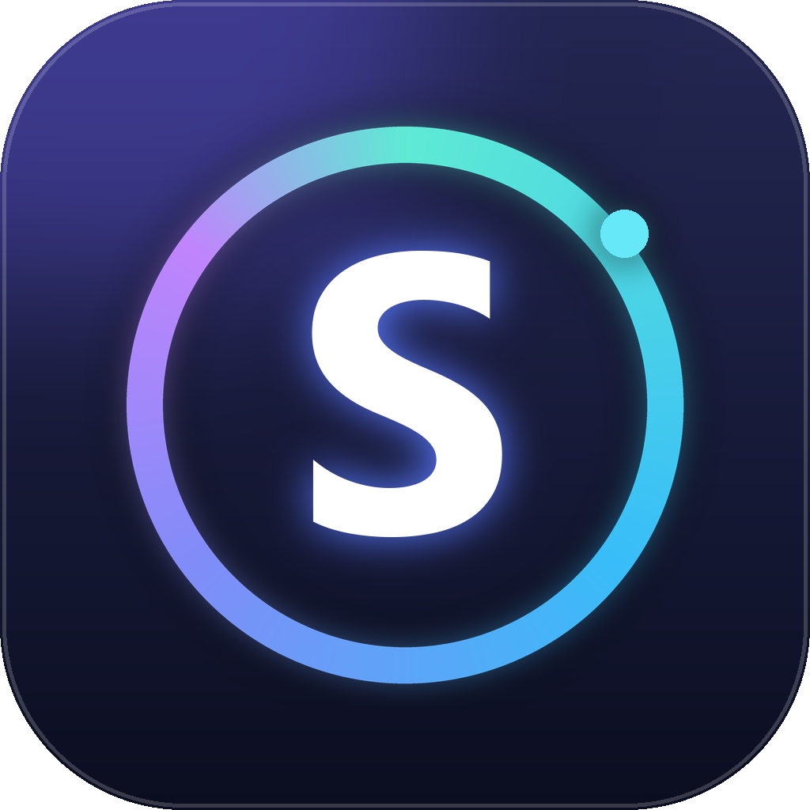

# Sirius Browser Engine 0.0.1

Sirius is a lightweight browser with a **custom rendering engine** written in C# and an interface in Python/Tkinter. It doesn’t use Chromium, WebView, or JavaScript: the page loads, parses, styles, and breaks down into text blocks that Tkinter draws on a “paper” canvas. This approach ensures fast startup, small size, and predictable reading of websites, news, documentation, and search results.

## What the 0.0.1 version can do

- Own HTTP client: gzip/brotli, redirects, cookies, timeouts, encoding detection (UTF-8, Windows-1251, KOI8-R, etc.).
- Tolerant HTML tokenizer and parser, DOM tree, HTML entity decoding.
- A subset of CSS: selectors by tag, class, id, and attributes, cascade and specificity, `display`, colors, alignment, `@media screen`.
- External style sheets from the same host (up to 3 files, with cache).
- Text layout: headings, paragraphs, lists, quotes, tables with column alignment
